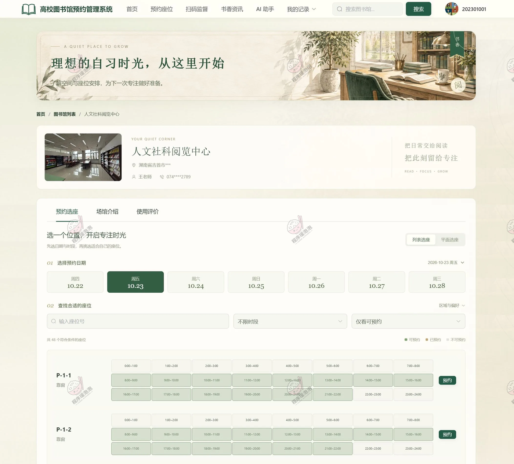
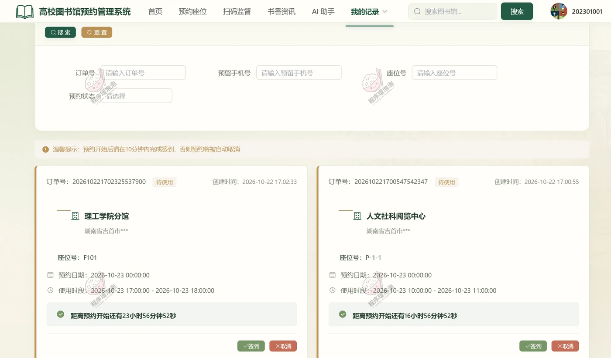
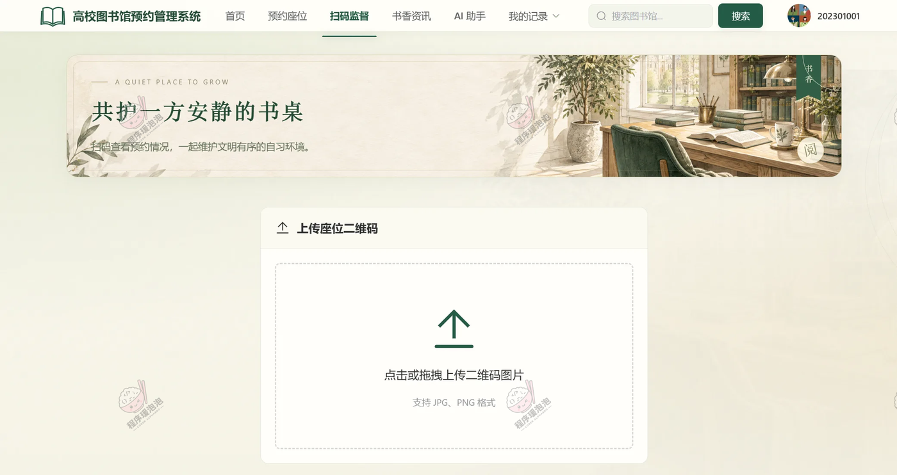
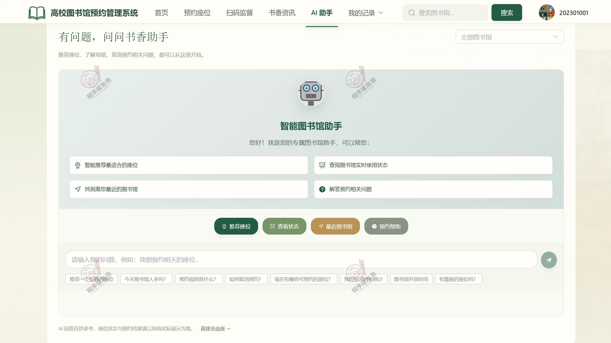
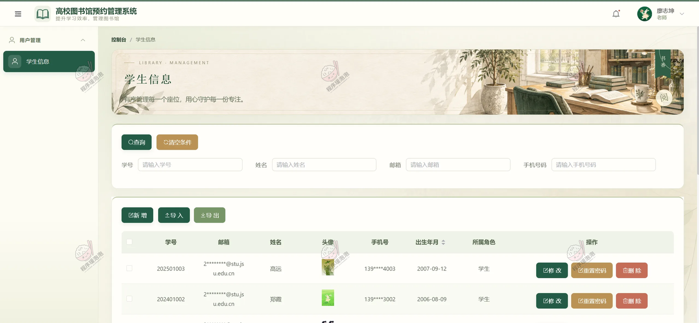
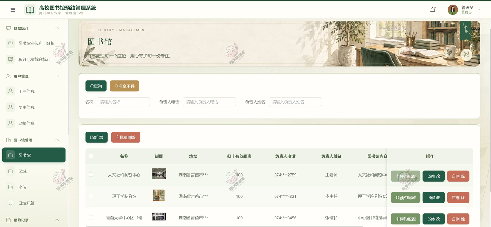
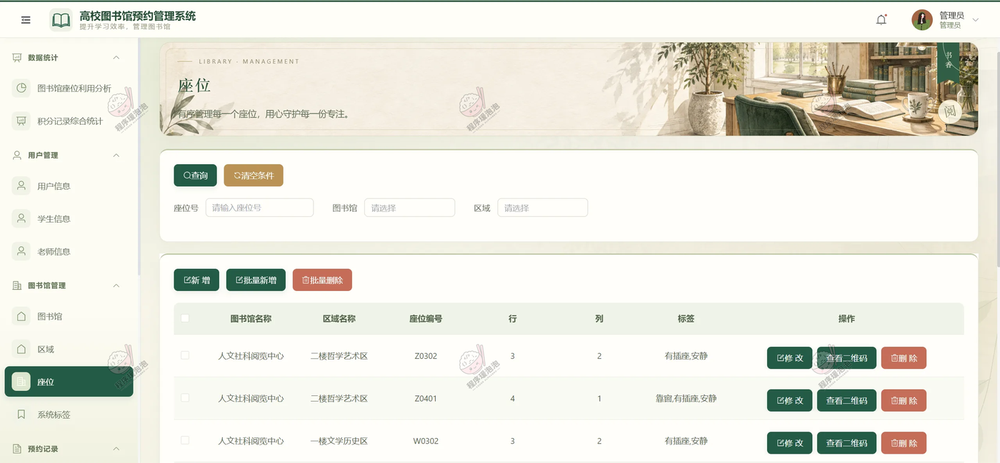
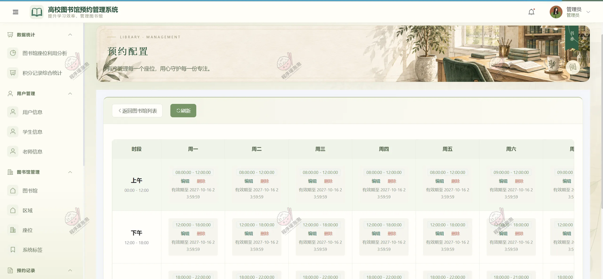
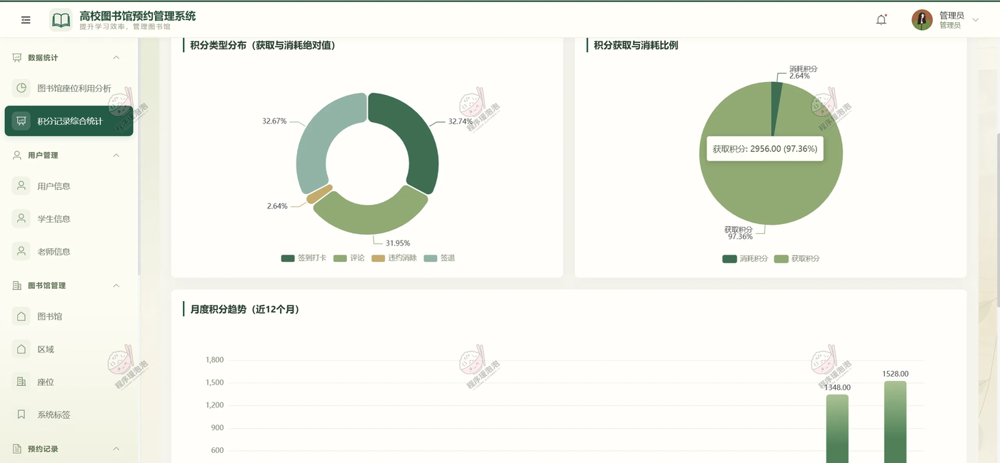

# CollegesLibraryManger
图书管理系统 计算机毕业设计 角色：学生、教师、管理员；亮点：AI助手、协同过滤算法、腾讯地图api、Echarts图形化分析、二维码识别；

所有源码均本人开发，项目是前后端分离的，所有的项目都具备了完整的业务逻辑，不仅仅局限于基础的增删改查（CRUD）操作，系统亮点众多。

本文注重于计算机毕业设计选题指导，列出题目均有源码， 大家可以去【公众号】(毕业终点站)获取或者加我【qq】(2112698948)提意见(别忘记Star哟)。备注：git

声明：仅用于学习使用，请勿用于任何商业行为！

1.系统非商用，非开源，非无偿。

2.由本人开发，如需源码，请联系以下方式，qq:2112698948。

3.项目有很多，并未全部上传，如果未找到想要的，可直接咨询。

# 高校图书馆预约管理系统

> 基于 Spring Boot 3 + Vue 3 的前后端分离图书馆预约平台，管理员 / 老师 / 学生三角色协同。
> 集成 DeepSeek 智能助手、意图识别、腾讯地图、Haversine 距离算法、预约时段校验、二维码签到与监督、定时违约处理、QQ 邮箱通知、ECharts 统计与学习成长体系。

## 一、项目简介

这是一套面向高校图书馆的座位预约系统。学生在网页上查空位、选时段、预约、扫码签到、暂离、签退；老师维护学生信息；管理员统筹场馆、座位、预约配置和运营数据——三方围绕"占座自习"这条主线协作。

系统里几个花心思的地方：

- **DeepSeek 智能助手**：结合真实场馆、座位和预约数据回答问题，用历史预约时段与场馆偏好辅助推荐，并保存会话记录供上下文使用。
- **意图识别**：关键词规则 + 大模型识别用户需求，把查座位、查场馆、查预约、查学习数据分流到对应业务查询。
- **腾讯地图 + Haversine 距离算法**：后台地址检索、地图选点、场馆位置与签到范围提示；按经纬度算球面距离，用于签到范围校验和附近图书馆排序。
- **预约时段校验**：结合开放配置、已有预约和时间区间判断可用座位，前端支持连续时段选择，减少预约冲突。
- **二维码签到与监督**：座位二维码关联具体座位，支持摄像头扫码和图片识别，签到时核对预约座位，并提供扫码监督入口。
- **定时违约处理**：定期检查预约逾期、暂离超时和监督验证情况，配合积分规则维护座位使用秩序。
- **QQ 邮箱通知**：后端 SMTP 发送预约提醒，保存发送计划、状态与结果，方便查看业务通知情况。
- **学习成长体系**：按实际签到签退时长累计学习数据，计算连续学习天数、完成率和学习等级，让学习成果更直观。
- **座位预约闭环**：查看座位与时段 → 预约 → 签到 → 暂离 → 签退 → 评价 → 积分记录，覆盖日常自习的主要流程。

## 二、技术栈

| 分层 | 技术 |
|---|---|
| 架构 | B/S、MVC、前后端分离，用户网页端 + 管理后台，管理员 / 老师 / 学生角色划分 |
| 后端 | Java、Spring Boot 3、Spring MVC、MyBatis-Plus、MySQL 8、JWT、Spring 定时任务、JavaMail、LangChain4j |
| 前端 | Vue 3、Vite、Element Plus、Vue Router、Pinia、Axios、ECharts、AiEditor 富文本编辑器 |
| 业务集成 | DeepSeek 智能助手、腾讯地图、QQ 邮箱 SMTP、二维码生成与识别 |
| 环境 | Windows / IDEA / JDK 17 / Maven / Node.js |

## 三、系统功能

### 3.1 管理端
- 账号管理：学生 / 老师 / 系统账号维护，条件查询、分页、导入与导出
- 场馆管理：图书馆信息、地理位置、阅览区域和座位标签，按行列批量生成座位及座位二维码
- 预约配置：按星期设置开放时段和有效日期，维护提前预约限制、签到距离与违约规则
- 预约管理：查询预约状态、签到签退和评价记录，支持辅助签到、提前结束及逾期记录查询
- 积分与通知：积分明细和邮件通知记录，跟踪积分获取、消耗与发送结果
- 内容管理：首页轮播、资讯分类、文章内容、显示与推荐状态，支持 AI 辅助写作
- 统计分析：座位使用率、积分趋势与排行、文章分类、互动数据和热门文章

### 3.2 老师端
- 学生信息管理：按学号、姓名、邮箱、手机号码查询，分页、新增、修改与删除
- 学生账号维护：学生账号、联系方式、出生日期及头像，支持重置学生密码
- 学生数据导入导出：模板导入学生资料，按查询条件导出学生数据
- 个人账户管理：老师账号登录、个人资料维护、修改密码及退出登录

### 3.3 学生用户端
- 注册登录、密码找回、个人资料维护、头像上传与密码修改
- 浏览图书馆与校园资讯，按关键词搜索场馆、地址和文章
- 查看场馆地图、阅览区域、座位布局及可预约时段，选连续时段提交预约
- 预约记录中完成取消、签到、扫码签到、暂离、恢复使用、签退和阅览评价
- 扫描或上传座位二维码，查看当前预约信息并参与座位监督
- 查看积分明细、违约情况，按规则用积分消除预约违约
- 查看学习总时长、学习天数、贡献热力图、周学习趋势和成长等级
- 浏览资讯并点赞、收藏，查看个人浏览、点赞和收藏记录
- 用 AI 助手咨询开放时间、可用座位、预约规则和个人学习情况，获取选馆选座建议

## 四、系统截图

以下选取 10 张代表性截图，按三个角色分别展示。源文档首图为登录入口页，未提供独立的系统总览图。

### 4.1 学生端

**首页** —— 查空位搜索条（选图书馆 / 日期 / 时段）与实时可预约数量，下方是学习空间卡片和"我的预约"入口。

**预约选座** —— 先选预约日期，再按区域、座位号和时段筛选，座位时段网格用三色区分可预约 / 已预约 / 不可预约，直观呈现预约时段校验结果。

**我的记录** —— 订单筛选与预约卡片，含图书馆、座位号、预约日期、使用时段和签到倒计时；页面提示预约开始后需在 10 分钟内完成签到，否则自动取消。

**扫码监督** —— 上传座位二维码图片入口，签到时核对预约座位，也可参与座位监督。

**AI 助手** —— 智能图书馆助手提供智能推荐座位、查询实时使用状态、找最近图书馆、解答预约问题四类入口，配合输入框和示例问题完成意图分流。

### 4.2 老师端

**学生管理** —— 按学号 / 姓名 / 邮箱 / 手机号查询学生，支持新增、模板导入与数据导出，可修改资料、重置密码和删除，是老师端的核心功能。

### 4.3 管理端

**图书馆管理** —— 图书馆资料列表含地址、打卡有效距离和负责人信息，配合地图选点维护场馆位置与签到范围。

**座位管理** —— 按图书馆 / 区域维护座位编号、行列和标签，支持批量生成座位与二维码，并逐座查看二维码。

**预约配置** —— 按星期设置开放时段与有效日期，维护提前预约限制、签到距离和违约规则，是预约时段校验与定时违约处理的规则来源。

**数据分析** —— 积分类型分布、积分获取与消耗比例、月度积分趋势，对应学习成长与积分体系的运营视图。

---

文档展示 10 张截图，需要了解更多，请联系我。
